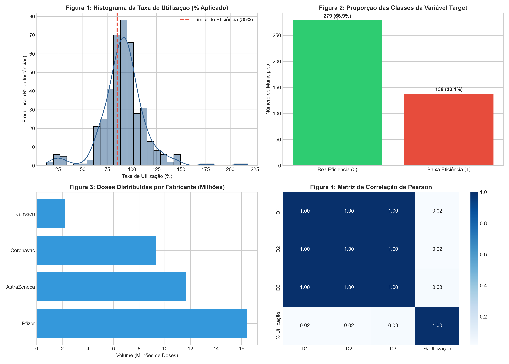

# 💉 Machine Learning para Previsão de Eficiência Logística de Vacinação (SESAB/BA)

> Curso: Inteligência Artificial — SENAI CIMATEC  
> Estudante: João Vitor Oliveira 
> Modulo: Desenvolvimento de Modelos de Machine Learning (Sprint 03)  
> Local/Ano: Salvador — 2026  

---

## 📌 Visão Geral do Projeto

Durante a campanha de imunização contra a COVID-19, o Estado da Bahia enfrentou desafios logísticos significativos para garantir a aplicação ágil de imunizantes nos 417 municípios. Este repositório contém o pipeline reprodutível em Python para **Análise Exploratória de Dados (EDA)** e **Modelagem Preditiva** baseada nos dados abertos consolidados da **Secretaria da Saúde do Estado da Bahia (SESAB/DIVEP)**.

O objetivo de negócio consiste em construir um modelo de Machine Learning sob o paradigma do **Aprendizado Supervisionado (Classificação Binária)** para prever se um município baiano apresentou **Baixa Eficiência Operacional** (utilização < 85% das doses recebidas até junho de 2023).

---

## 📊 Estrutura do Dataset

O conjunto de dados unificado resulta do *merge* entre duas bases oficiais do portal `dados.gov.br`:
1. **Doses Distribuídas e Aplicadas (26/06/2023)**
2. **Consolidado de Vacinação por Município (26/06/2023)**

- **Escopo:** 100% dos municípios baianos ($N = 417$).
- **Variável Alvo (Target):** 
  - `0`: **Boa Eficiência** ($\ge 85\%$ de aplicação) — 279 municípios ($66,9\%$)
  - `1`: **Baixa Eficiência** ($< 85\%$ de aplicação) — 138 municípios ($33,1\%$)

---

## 📈 Painel de Análise Exploratória (EDA)

O script automatizado gera o painel visual consolidado dos dados:



### Principais Destaques da EDA:
* **Figura 1 (Histograma):** Concentração de uso entre $75\%$ e $105\%$, com pico em $\approx 90\%$. Presença de dispersões extremas associadas a defasagens de notificação e ajustes populacionais.
* **Figura 2 (Target):** Desbalanceamento moderado de classes (proporção $2:1$), exigindo avaliação por $F1\text{-Score}$, Precisão, Revocação (*Recall*) e Matriz de Confusão.
* **Figura 3 (Fabricantes):** Predominância do volume de doses atribuído à Pfizer ($16,4\text{ M}$), seguida por AstraZeneca ($11,6\text{ M}$), CoronaVac ($9,3\text{ M}$) e Janssen ($2,1\text{ M}$).
* **Figura 4 (Correlação):** Alta multicolinearidade entre etapas vacinais (D1, D2, D3), mas ausência de associação linear expressiva entre o volume absoluto de doses e a taxa percentual de eficiência.

---

## 🛠️ Como Executar o Código

### Pré-requisitos
Certifique-se de possuir o **Python 3.10+** instalado em sua máquina.

### 1. Clonar o Repositório
```bash
git clone https://github.com/joaovos/vacinacao-covid19-bahia-ml.git
cd vacinacao-covid19-bahia-ml
